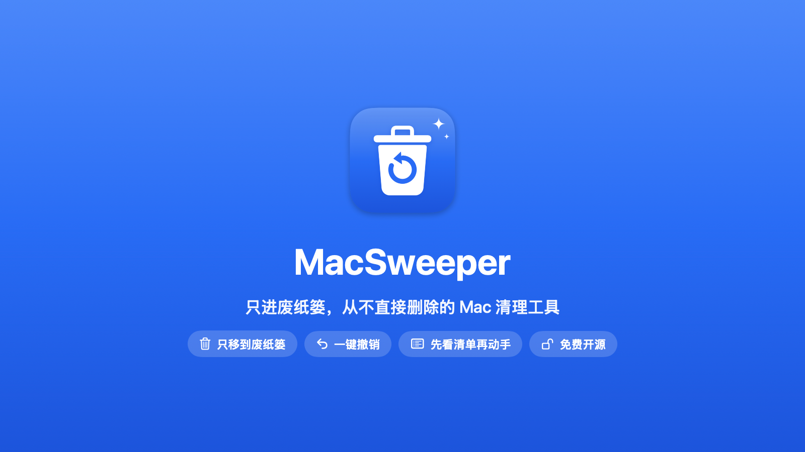
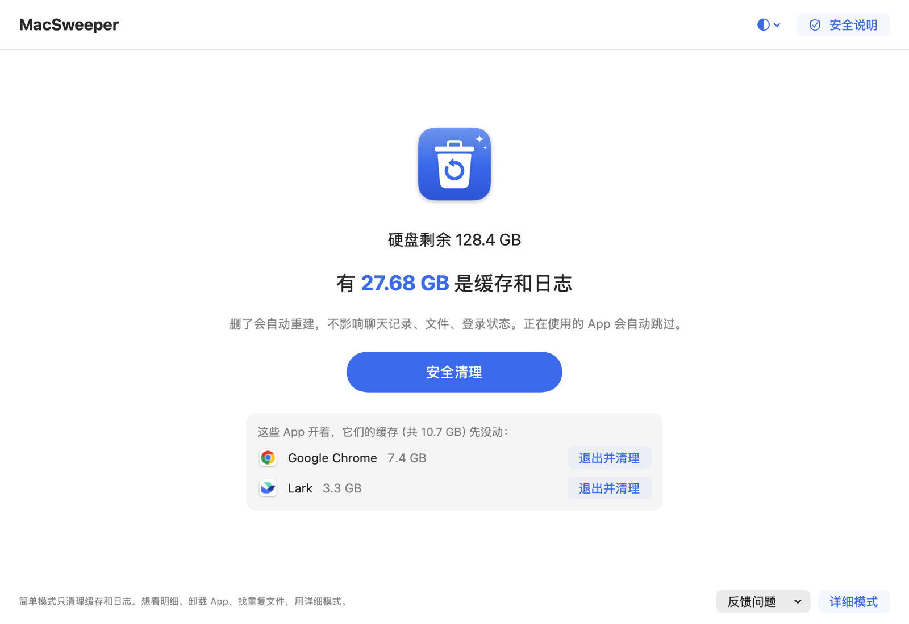
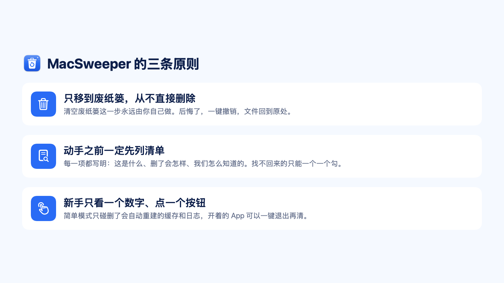
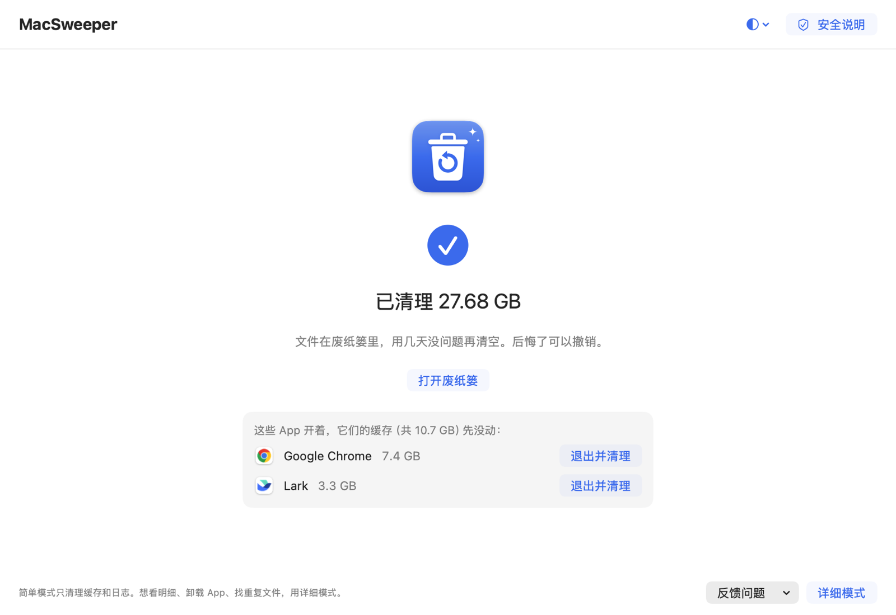
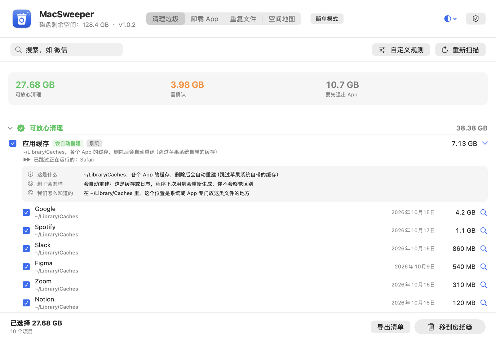
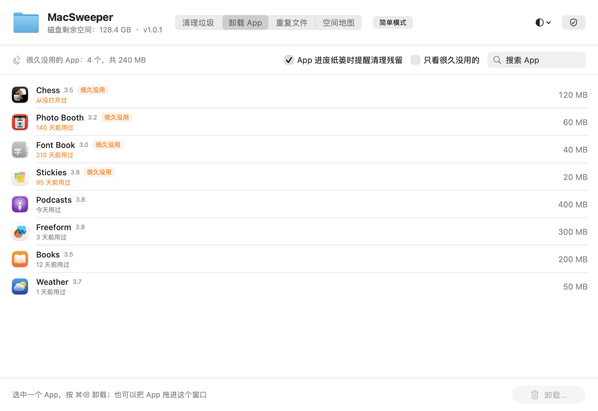
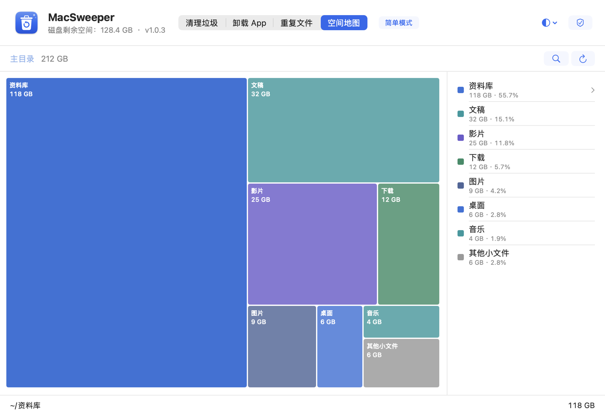

# MacSweeper 宣传文案

- 下载：https://github.com/bianzigege/MacSweeper/releases
- 反馈：App 里的"反馈问题"，或写信到 bianzigege2026@gmail.com

> 文中的飞书 34GB、Chrome 26GB、微信 22GB 来自作者电脑 2026 年 10 月的一次扫描。发之前可以用 MacSweeper 再扫一次，换成最新的数字。
> 配图在 `宣传配图/` 文件夹里，界面截图用的都是演示数据（虚构的 App 和文件夹），不含任何真实电脑信息。

---

## 标题备选

- 我 Mac 上最占地方的三样东西，全是"浏览器缓存"
- 微信里藏着一个浏览器，它在我电脑上存了 22GB
- 一个"胆小"的清理工具：它从来不删东西

---

## 公众号 / 小红书版（主文案）

先问你一个问题：你觉得 Mac 上最占空间的是什么？照片？视频？

我查了一下自己的电脑，排前三的是：
飞书 34GB，Chrome 26GB，微信 22GB。

而且都不是聊天记录，是"浏览器缓存"。飞书和微信里都藏着一个浏览器，你点开公众号文章、打开文档链接时用的就是它。每打开一个网页，它就悄悄存一份，存了从来不删。三样加起来 82GB，比我硬盘剩下的空间还多。

于是我做了一个清理工具，叫 MacSweeper。

*打开就是这样：一个数字，一个按钮*

**它有点"胆小"**

它从来不直接删除任何东西，只会把文件挪到废纸篓。清不清空废纸篓，你自己说了算。后悔了点一下撤销，文件原样回到原来的位置。

每一项它都会告诉你三件事：这是什么、删了会怎样、它是怎么判断的。"删了会怎样"只有三种答案：会自动重建、要重新下载、找不回来。找不回来的，只能你一个一个亲手勾。

*清理完，文件都在废纸篓里，后悔了可以撤销*

**我为什么要做它**

那天电脑弹窗提醒空间不足，我试了几个清理软件。要么收费，要么一键清理完，我根本不知道它删了什么。万一删掉的是聊天记录，或者是我做了一半的项目呢？

我平时还用 Codex、Claude 这些 AI 工具做东西，做完就扔在那儿，不知不觉又堆了几十 GB。

我想要的其实很简单：先告诉我这是什么，再让我决定，删错了还能找回来。找不到这样的工具，就自己做了一个。

**它能帮你做什么**

- **简单模式**：打开就是一个数字、一个按钮。只清删了会自动重建的缓存和日志，不碰聊天记录、文件和登录状态。微信、Chrome 这些开着的 App 会单独列出来，点"退出并清理"，清完自动帮你重新打开。
- **详细模式**：每一项都有说明卡。还能卸载 App，连同它的缓存和设置一起，很久没用的排在最前面。也能找内容完全一样的重复文件，或者用色块看硬盘到底被谁占了。
- **AI 工具专项**：把 Codex、Claude 这些 AI 工具留下的旧对话、缓存、项目依赖分门别类列出来。
- **不收集、不上传**：除了每天查一次有没有新版本，它不联网。连检查更新都可以关掉。

*详细模式：每一类都标着"删了会怎样"，展开有说明卡*

*卸载 App：很久没用的排在最前面*

*空间地图：色块越大占得越多，点进去一层层看*

*安全说明页：六条承诺，还能自己查日志、看源代码*

免费、开源，代码全部公开在 GitHub 上，谁都可以检查。Apple 芯片和 Intel 芯片都能用，需要 macOS 13 以上。还支持浅色、深色两种外观。

**在哪下载**

https://github.com/bianzigege/MacSweeper/releases

下载最新版的 MacSweeper 安装包（.dmg 文件），打开后拖进"应用程序"。

第一次打开会被系统拦一下，因为我还没买苹果的开发者签名。打开"系统设置 → 隐私与安全性"，拉到最下面点"仍要打开"就行，之后正常双击。

用着有问题，点 App 里的"反馈问题"，或者写信给我：bianzigege2026@gmail.com

---

## 朋友圈版（短）

查了一下自己的 Mac，最占地方的三样全是浏览器缓存：飞书 34GB、Chrome 26GB、微信 22GB，加起来比我剩下的空间还多。

市面上的清理软件我不太敢用，一键清完也不知道删了啥。所以自己做了一个"胆小"的：只挪到废纸篓，从不直接删，后悔了一键撤销；每一项都写明是什么、删了会怎样。

免费开源，下载：https://github.com/bianzigege/MacSweeper/releases

---

## 一句话版（签名、转发语）

- 一个"胆小"的 Mac 清理工具：只挪到废纸篓，从不直接删，后悔了一键撤销。
- 微信和飞书里藏着浏览器，它们的缓存可能比你的照片还大。这个工具帮你安全清掉。
- 免费开源的 Mac 清理工具，每一项都告诉你是什么、删了会怎样。

---

## 英文版（Twitter / Reddit r/macapps）

The three biggest things on my Mac were all browser caches: Feishu 34 GB, Chrome 26 GB, WeChat 22 GB. Chat apps hide a browser inside, and it never cleans up after itself.

So I built MacSweeper, a free open-source Mac cleaner for people who don't trust cleaners:

- Everything goes to the Trash, never deleted. One-click undo.
- Every item says what it is, what happens if removed, and how we know.
- Simple mode: one number, one button. Only caches that rebuild themselves. Open apps are listed with a "Quit and Clean" button that reopens them afterwards.
- Detailed mode: uninstall apps with their leftovers, find duplicates (APFS clones recognized), see a space map.
- No tracking. The only network access is a daily version check, and you can turn it off.

Native SwiftUI, Apple silicon + Intel, macOS 13+. MIT.
Download: https://github.com/bianzigege/MacSweeper/releases
Feedback: bianzigege2026@gmail.com

---

## GitHub 仓库简介（About 栏，已设置）

安全、透明、免费的 Mac 垃圾清理工具 · 原生 SwiftUI · 只移到废纸篓，从不直接删除
